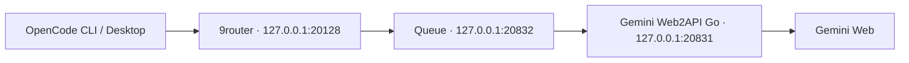

# Gemini qua OpenCode

Bản tổng hợp mã nguồn và kết quả thử nghiệm tích hợp Gemini Web vào OpenCode CLI/Desktop, tách từ J.A.R.V.I.S Agents ngày **27/10/2026**.

**Trạng thái: lưu trữ thử nghiệm.** Người dùng hủy dự án runtime ngày 26/10/2026; lần xuất bản này chỉ đóng gói mã nguồn, không khởi động lại dịch vụ. Đây là adapter Gemini Web2API Go, không phải Google Gemini CLI chính thức. Các tên model dưới đây là alias của pilot, không xác nhận tên sản phẩm hay quyền truy cập hiện tại của Google.



## Phần đã làm

- Binding danh tính tài khoản xuyên XSRF, header, RPC, upload, conversation và media; import có kiểm tra danh tính, transaction và operation ID.
- Bridge Argon High chuyển JSON action plan thành OpenAI-compatible tool calls; kiểm tên tool, arguments, tool choice và kết quả. OpenCode thực thi tool theo quyền của chính client.
- Chặn prompt Argon vượt byte budget trước upload/SSE; trả `context_length_exceeded` thay vì ngầm cắt nội dung.
- Chặn reported model khác family Argon trước khi phát nội dung/reasoning ở High+tools.
- Queue tối đa 8 active / 32 waiting; không replay request có kết quả chưa rõ. Chỉ chờ lại khi Go từ chối rõ vì hết concurrent slot trước generation.
- Launchers Windows kiểm hash, listener và process ownership; giữ secret trong tiến trình, không đóng gói credential.

## Đọc và kiểm tra

- [Cách dựng và nối OpenCode](docs/setup.md).
- [Kết quả thử nghiệm, lỗi và giới hạn](docs/evidence.md).
- [Cấu hình OpenCode mẫu](examples/opencode.example.json): bốn alias chat của pilot, không bật quyền công cụ toàn cục.
- [Nguồn và giấy phép](THIRD_PARTY_NOTICES.md), [manifest nguồn](source-manifest.json).

Node.js 22+ chạy được bộ kiểm thử queue/protocol/preflight không gọi Google:

```powershell
npm test
```

Windows có PowerShell 7 và compiler .NET Framework chạy thêm fixture launcher:

```powershell
npm run test:windows
```

Các Go files trong `scripts/gemini-session-go/` là patch cho upstream, không phải Go module độc lập. Quy trình build nằm trong hướng dẫn. Repo không kèm Go binary, 9router, OpenCode, database, cookies, API keys, account mapping thật hay lịch sử chat.

## Mức độ đã chứng minh

Pilot 24/10 đã có các vòng tool đơn đi hết Go → 9router → OpenCode và nonce khớp. Chuỗi nhiều tool có cả lần đạt lẫn premature final, malformed JSON và upstream hạ model; **High-only multi-tool chưa được nghiệm thu**. Metadata context 500k/output 65536 trong cấu hình lịch sử không chứng minh backend nhận được từng đó token. Prompt cap 128000 là **UTF-8 bytes của prompt đã serialize**, không phải 128k token.

Không dùng kết quả unit test hoặc HTTP 200 để khẳng định chất lượng model, quota, billing, độ ổn định hay phiên đăng nhập hiện tại.
