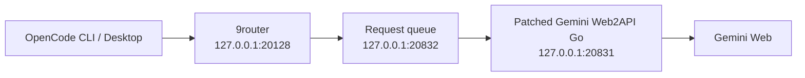

<div align="center">

# Gemini × OpenCode

**Explore Gemini Web tool calling from OpenCode.**

A pinned Go adapter, a bounded request queue, and reproducible tests for developers investigating the boundary between web chat and local coding tools.

[](https://github.com/Sonness1304/gemini-opencode/actions/workflows/tests.yml)
[](LICENSE)
[](package.json)
[](docs/evidence.md)

[Quick start](#quick-start) · [Setup guide](docs/setup.md) · [Architecture](docs/architecture.md) · [Results](docs/evidence.md) · [Troubleshooting](docs/troubleshooting.md)

</div>

---

## What is this?

Gemini × OpenCode connects **OpenCode CLI/Desktop** to a patched **Gemini Web2API Go** backend through a local **9router** gateway and request queue. The bridge converts a validated JSON action plan into tool calls that OpenCode can execute.

This repository collects the adapter source, patch recipe, Windows launcher references, and tests from the J.A.R.V.I.S Agents pilot. It is intended for developers studying tool emulation, account binding, streaming, and context limits.

> **Project status:** experimental source archive. Runtime development was cancelled on October 26, 2026. Publishing this repository does not restart that work. This is a Gemini **Web** adapter, not Google's official Gemini CLI. Pilot model names are routing aliases, not a promise of current Google availability.

## Why explore it?

| Area | What you can inspect |
| --- | --- |
| **Tool-call bridge** | JSON plan validation, tool selection, argument checks, tool-result correlation, and final-answer handling |
| **Account binding** | Identity checks carried through tokens, headers, RPCs, uploads, conversations, and media |
| **Request queue** | Bounded concurrency, cancellation, deadlines, and explicit refusal handling |
| **Context preflight** | A UTF-8 byte budget checked before uploads or streaming begin |
| **Model identity** | A guard against explicitly reported model downgrades before output is emitted |
| **Reproducible patches** | An exact upstream revision and 62 source-file hashes checked before any patch is written |

## How it fits together



The Go bridge proposes structured actions. **OpenCode owns tool execution and permissions.** The queue forwards requests; it never executes model-generated commands.

## Quick start

Start with the local test suite. It requires **Node.js 22+**, no npm dependencies, and no Google credentials.

```bash
git clone https://github.com/Sonness1304/gemini-opencode.git
cd gemini-opencode
npm test
```

On Windows with PowerShell 7 and the .NET Framework C# compiler:

```powershell
npm run test:windows
```

**To rebuild the adapter and connect OpenCode**, follow the [setup guide](docs/setup.md). The Go files here are patches for a pinned upstream application, not a standalone Go module. The repository does not include an installer or configured gateway.

## What has been verified?

| Check | Result | Scope |
| --- | --- | --- |
| Queue, protocol, preflight, and repository integrity tests | **14 passed** | Local fixtures; no live model calls |
| Windows launcher tests | **2 passed** | Mocked startup/browser callbacks |
| Patched Go test suite | **100 test/subtest passes** | One live upload probe skipped; see [verification record](docs/publication-checks.md) |
| Patched Go build | **Passed** | Go 1.26.8 on Windows |
| Historical single-tool round trip | **Observed passing runs** | Tool call → newly generated nonce → exact final answer |
| High-only multi-tool chains | **Not accepted** | Mixed model reports, premature finals, and malformed replies remain |

These are separate checks, not a combined benchmark. The [evidence guide](docs/evidence.md) includes failures and explains what each result proves.

## Know the limits

- Tool calling is **prompt-based emulation**, not Google's native function-calling API.
- HTTP 200 or an OpenCode `succeeded` status does not prove that a requested file was written or a tool chain completed.
- A historical `500000` context setting is client metadata. The pilot's `128000` prompt cap counts **UTF-8 bytes of the serialized prompt**, not tokens.
- Account login, quota, session expiry, reboot recovery, and media support require their own live verification.
- The repository contains no credentials, account database, browser session, chat history, or prebuilt executable.

## Documentation

| Guide | Start here when you want to… |
| --- | --- |
| [Setup](docs/setup.md) | Rebuild the pinned Go application and configure the local chain |
| [Architecture](docs/architecture.md) | Understand the adapter, queue, and execution boundaries |
| [Troubleshooting and FAQ](docs/troubleshooting.md) | Investigate context errors, model mismatches, or incomplete tool chains |
| [Evidence](docs/evidence.md) | Review historical results and unresolved limitations |
| [Publication checks](docs/publication-checks.md) | Inspect the exact checks performed for this export |
| [Contributing](CONTRIBUTING.md) | Propose a focused improvement with reproducible evidence |
| [Source and licensing](THIRD_PARTY_NOTICES.md) | Trace upstream revisions, original files, and local edits |

## Explore or contribute

Run the tests, read the bridge, and compare its contracts with your own client. Useful contributions include small reproductions of protocol failures, clearer setup instructions, and tests that catch false success reports. Read [CONTRIBUTING.md](CONTRIBUTING.md) before opening a pull request.

## License

[MIT](LICENSE). Upstream copyright and license notices are preserved in [THIRD_PARTY_NOTICES.md](THIRD_PARTY_NOTICES.md).
