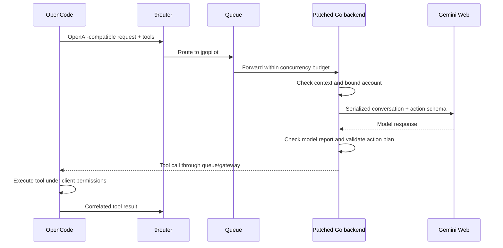

# Architecture

## Request path

This describes the intended protocol. A response can fail validation or end prematurely; it is not a claim that every live chain completes.

## Components

| Path | Responsibility |
| --- | --- |
| `tooling/gemini-session-go/patch.mjs` | Validate the exact source archive, then apply the integration |
| `tooling/gemini-session-go/source-hashes.json` | SHA-256 manifest of the 62 upstream files |
| `scripts/gemini-session-go/account_binding*.go` | Selected-account identity, request binding, storage, import, and rotation coordination |
| `scripts/gemini-session-go/action_bridge*.go` | Argon High JSON plan, parser, tool/schema checks, and model guard |
| `scripts/gemini-session-go/context_budget*.go` | Prompt-byte preflight before transport work |
| `scripts/gemini-go-queue.mjs` | Bounded HTTP queue, cancellation, deadlines, and forwarding |
| `scripts/pilot-gemini-tool-roundtrip.mjs` | Optional live nonce diagnostic; unit tests use an injected sender |
| `scripts/start-*.ps1` | Historical Windows service launch references |
| `scripts/test-gemini-session.ps1` | Session health check without generation |
| `examples/opencode.example.json` | Four pilot chat routes using an environment-supplied gateway key |

## Tool execution boundary

The web model does not receive a native registry of local executable tools. The bridge supplies a JSON planning contract with `next_action` and `final_answer`. It validates the response and constructs an OpenAI-compatible tool call.

OpenCode remains responsible for tool implementations, complete client-side schema validation, and permissions. The bridge is not a full JSON Schema validator. It does not execute shell commands or interpret arbitrary model text as code.

For High requests with tools, content and reasoning are buffered until relevant checks complete. An explicitly reported model outside the Argon family is rejected. A missing or family-level identity still does not attest the exact High tier.

## Queue behavior

The queue accepts only its intended API routes and uses a fixed loopback upstream. It enforces authentication, request size, queue capacity, and deadlines.

It may wait and retry after Go explicitly reports a concurrent-slot refusal before generation. It preserves quota and context errors, and does not replay timeouts or unknown outcomes.

The queue's HTTP body size limit and Go's serialized-prompt byte budget measure different things. Neither is a token-window guarantee.

## Account and session binding

Bindings pair a selected account index with an expected identity. The patch carries this binding through token lookup, headers, RPC URLs, uploads, conversations, and media. Missing, mismatched, or ambiguous identities are rejected where binding is required.

A binding selector does not make a shared browser cookie jar a cryptographically isolated credential. Session acquisition remains separate from this source export. No account sessions or real identity mappings are included.

## Source integrity

The recipe checks the full source-file list and every expected hash before writing patches. Tests cover rejection of an unexpected tree and changed source bytes.

The exported-file manifest is separate from the upstream archive manifest: one traces this repository's provenance; the other protects the patch's source contract.
